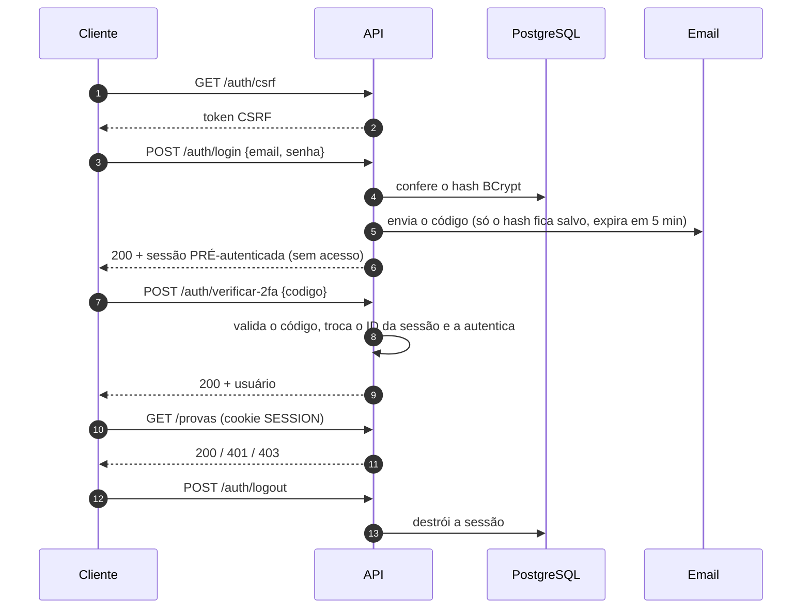
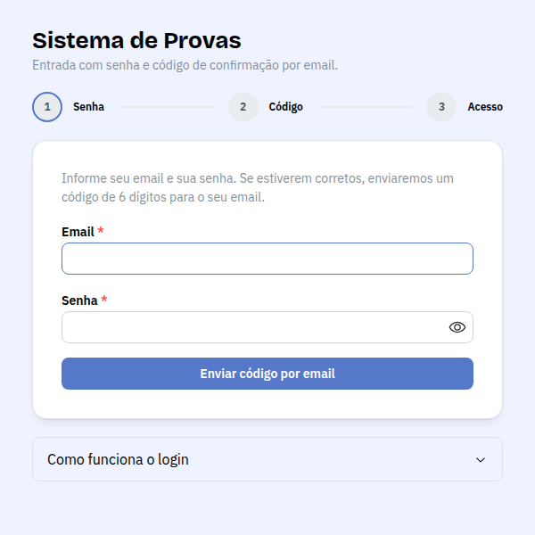
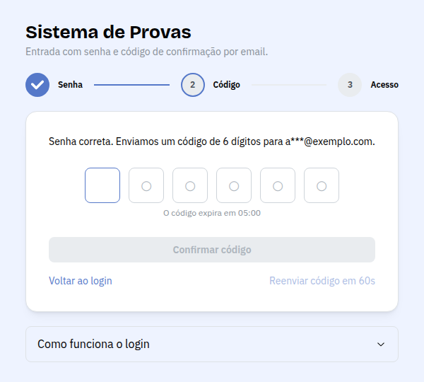
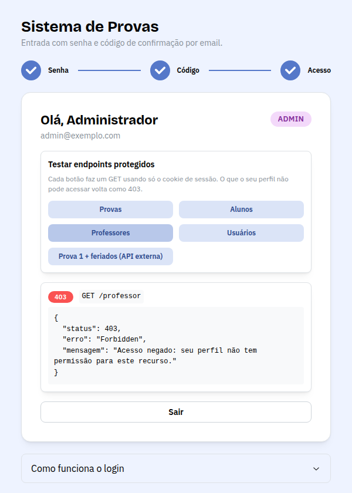

<div align="center">

# 📝 Sistema de Provas Acadêmicas

**API REST com login por sessão + 2FA por email, e front de login em React**


AV2 · Técnicas de Integração de Sistemas · UNIFOR

🌐 **Deploy:** https://frontend-y286.onrender.com

</div>

---

## 🎯 O sistema

API para cadastrar **alunos**, **professores** e **provas**, com dados sensíveis (CPF, salário, notas) protegidos por perfil.

- 👩‍💼 **Admin:** gerencia tudo, inclusive as contas de acesso.
- 👨‍🏫 **Professor:** gerencia as provas dele.
- 🎓 **Aluno:** consulta só as próprias provas e o próprio cadastro.

Recursos: **Aluno**, **Professor** e **Prova** (mín. 7 campos cada) e **Usuário** (login). Exclusões são lógicas. Na primeira execução o banco recebe 3 professores, 3 alunos e 3 provas.

---

## 🔐 Autenticação: sessão + 2FA por email

Login por **sessão (cookie HttpOnly)** com **senha (BCrypt)** e **código de 6 dígitos enviado por email**. Não usamos Basic, Bearer/JWT, OAuth 2.0 nem API Key.



**Por que essa escolha:** a sessão fica no servidor, então o logout e o bloqueio valem na hora; o cookie `HttpOnly` não é lido por JavaScript; e o segundo fator protege contra senha vazada. As sessões ficam no PostgreSQL (Spring Session JDBC).

**Pontos fortes:** revogação imediata, cookie `HttpOnly` + `SameSite=Strict`, código de uso único e permissões por perfil e por posse.

**Pontos fracos:** exige guardar sessão no servidor e proteção CSRF; não é ideal para app mobile nem comunicação entre serviços; o email é um 2º fator mais fraco que TOTP.

| Segurança | Como |
|---|---|
| Senha | BCrypt (custo 12), mínimo de 10 caracteres |
| Código 2FA | `SecureRandom`, só o hash salvo, expira em 5 min, 5 tentativas, uso único |
| Sessão | Expira em 30 min; ID trocado ao autenticar |
| Rate limit | 10 req/min por IP nos endpoints de login; 120 req/min no total |
| Força bruta | 5 senhas erradas bloqueiam a conta por 15 min |
| CSRF | Cookie `XSRF-TOKEN` + header `X-XSRF-TOKEN` |
| Validação e erros | Bean Validation; 400/401/403/404/409/429/502/503 padronizados, sem vazar stack trace |

---

## 👥 Permissões

| Recurso | ADMIN | PROFESSOR | ALUNO |
|---|:---:|:---:|:---:|
| `GET /alunos` | ✅ completo | ✅ resumo | ❌ 403 |
| `GET /alunos/{matrícula}` | ✅ | ✅ resumo | ✅ só o próprio |
| `POST/PUT/DELETE /alunos` e `/professor` | ✅ | ❌ 403 | ❌ 403 |
| `GET /professor` | ✅ completo | ✅ próprio completo, outros resumo | ✅ resumo |
| `GET /provas` | ✅ todas | ✅ só as dele | ✅ só as dele |
| `POST/PUT/DELETE /provas` | ✅ | ✅ só as dele | ❌ 403 |
| `/usuarios` | ✅ | ❌ 403 | ❌ 403 |
| `/integracao/**` | ✅ | ✅ | ❌ 403 |

---

## 🚀 Como rodar

**Pré-requisitos:** Java 17+, PostgreSQL, Node 18+.

```bash
# 1) banco vazio
createdb crud_av2

# 2) backend (http://localhost:8080)
cd backend
cp .env.example .env        # preencha os valores
./mvnw spring-boot:run      # Windows: mvnw.cmd spring-boot:run

# 3) front-end (http://localhost:5173)
cd ../frontend
npm install
cp .env.example .env
npm run dev
```

Abra `http://localhost:5173`, entre com uma conta de `SEED_*` e digite o código recebido por email (ou o que aparece no console do backend, com `MAIL_PROVIDER=console`).

> 🔑 Não há usuário fixo no código: as contas iniciais nascem das variáveis `SEED_*`.

### Variáveis (`backend/.env`)

| Variável | Descrição |
|---|---|
| `DATABASE_URL`, `DATABASE_USER`, `DATABASE_PASS` | Conexão com o PostgreSQL |
| `COOKIE_SECURE` | `false` em HTTP local; `true` em HTTPS |
| `MAIL_PROVIDER` | `console` (log), `smtp` (Gmail) ou `resend` |
| `MAIL_FROM`, `SMTP_HOST`, `SMTP_PORT`, `SMTP_USER`, `SMTP_PASS` | Gmail: senha de app de 16 letras |
| `RESEND_API_KEY` | Se `MAIL_PROVIDER=resend` |
| `SEED_ADMIN_EMAIL`, `SEED_ADMIN_PASSWORD` | Admin inicial (senha com 10+ caracteres) |
| `SEED_PROFESSOR_EMAIL`, `SEED_ALUNO_EMAIL`, `SEED_USER_PASSWORD` | Contas de demonstração |

Front-end (`frontend/.env`): `VITE_API_TARGET`, o endereço da API.

---

## 📡 Usando a API

Como é cookie + CSRF, use um *cookie jar* e envie `X-XSRF-TOKEN` nos `POST/PUT/DELETE`. Script completo: [`backend/docs/exemplos-curl.sh`](backend/docs/exemplos-curl.sh).

```bash
BASE=http://localhost:8080; JAR=jar.txt

curl -s -c $JAR -b $JAR $BASE/auth/csrf
XSRF=$(awk '$6=="XSRF-TOKEN"{print $7}' $JAR | tail -n1)

# etapa 1: senha (o código chega por email)
curl -s -c $JAR -b $JAR -X POST $BASE/auth/login \
  -H "Content-Type: application/json" -H "X-XSRF-TOKEN: $XSRF" \
  -d '{"email":"admin@exemplo.com","senha":"SUA_SENHA"}'

# etapa 2: código
XSRF=$(awk '$6=="XSRF-TOKEN"{print $7}' $JAR | tail -n1)
curl -s -c $JAR -b $JAR -X POST $BASE/auth/verificar-2fa \
  -H "Content-Type: application/json" -H "X-XSRF-TOKEN: $XSRF" \
  -d '{"codigo":"123456"}'

# rotas protegidas (GET só precisa do cookie)
curl -s -b $JAR $BASE/auth/me
curl -s -b $JAR $BASE/provas
```

**Insomnia/Postman:** o cookie jar é automático; faça `GET /auth/csrf` antes e envie `X-XSRF-TOKEN` com o valor do cookie `XSRF-TOKEN`.

| Método | Rota | Acesso |
|---|---|---|
| GET | `/auth/csrf` | pública |
| POST | `/auth/login`, `/auth/verificar-2fa`, `/auth/reenviar-codigo` | pública (2FA exige o login) |
| GET / POST | `/auth/me` / `/auth/logout` | autenticado |
| GET/POST/DELETE | `/usuarios` | ADMIN |
| CRUD | `/alunos`, `/professor`, `/provas` | ver permissões |
| GET | `/integracao/provas/{id}/calendario` | ADMIN, PROFESSOR |
| GET | `/integracao/alunos/{matricula}/localizacao?cep=` | ADMIN, PROFESSOR |

**Erros comuns** (formato `{"timestamp","status","erro","mensagem"}`):

| Situação | Resposta |
|---|---|
| Sem sessão autenticada | `401` |
| Senha errada ou código inválido | `401` |
| Perfil sem permissão (ex.: aluno em `/alunos`) | `403` |
| POST sem token CSRF | `403` |
| Dados inválidos | `400` + campos |
| Muitas requisições ou conta bloqueada | `429` |

---

## 🌎 Integração com API externa

Usamos a **[BrasilAPI](https://brasilapi.com.br)** (pública, sem chave) e combinamos com os dados locais:

| Endpoint | Chamada externa | Combinação |
|---|---|---|
| `GET /integracao/provas/{id}/calendario` | `/feriados/v1/{ano}` | Avisa se a prova cai em feriado nacional ou fim de semana |
| `GET /integracao/alunos/{matricula}/localizacao?cep=` | `/cep/v2/{cep}` | Junta o aluno com o endereço do CEP |

Falha na API externa vira `502`; CEP inexistente, `404`.

---

## 🖥 Front-end

Pasta [`frontend/`](frontend): React + Vite + Mantine, com o login em 3 etapas e dois painéis:

- **Admin:** aba **Gerenciar**, com listagem, criação, edição e exclusão de **alunos, professores, provas e usuários**; e aba **Testar endpoints**.
- **Professor e aluno:** painel para testar os endpoints protegidos (mostra os `200`, `401` e `403`).

O Vite repassa `/api/*` para o Spring, então os cookies funcionam sem CORS. No deploy, o Static Site usa uma regra de *Rewrite* (`/api/*` → API).

<div align="center">

| Senha | Código por email | Painel |
|:---:|:---:|:---:|
|  |  |  |

</div>

---

## 🗂 Estrutura

```
├── backend/    API Spring Boot (config, controllers, services, security, models...)
├── frontend/   React + Mantine (src/api.js, components/*)
└── docs/img/   prints
```

---

## 👨‍💻 Equipe

| Integrante | Matrícula | Contribuição principal |
|---|---|---|
| Nome 1 | 0000000 | ex.: autenticação e 2FA |
| Nome 2 | 0000000 | ex.: endpoints e permissões |
| Nome 3 | 0000000 | ex.: integração com API externa |
| Nome 4 | 0000000 | ex.: front-end |
